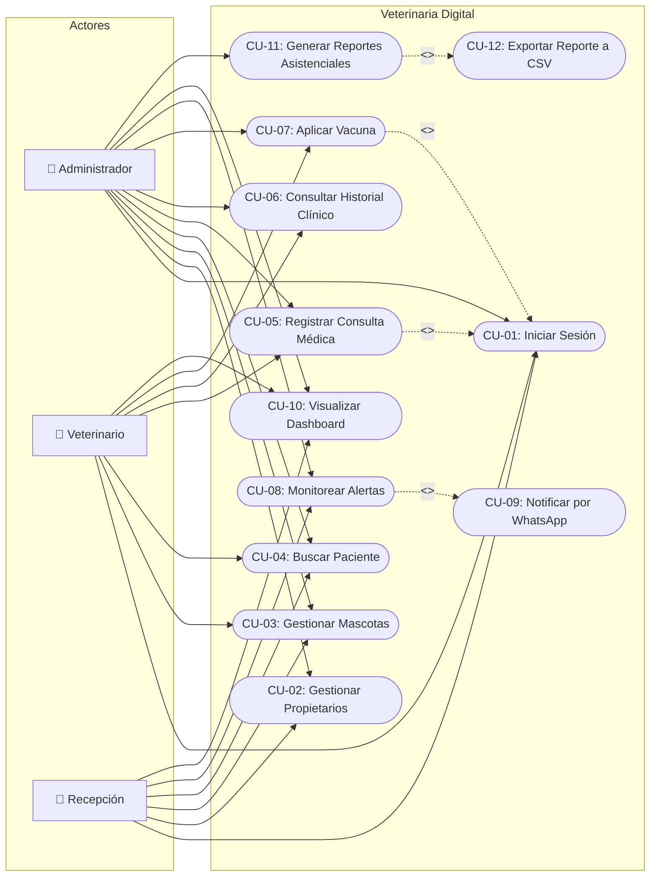

# Diagrama y Especificación de Casos de Uso (Sesión 2)
**Proyecto N.º 2:** Veterinaria Digital  
**Aprendiz:** Johan Muñoz  
**Tecnólogo en Análisis y Desarrollo de Software (ADSO)** · SENA  
**Instructora:** Joan Castillo Celis  
**Referencia:** ISO/IEC/IEEE 29148:2018 / UML 2.5  

---

## 1. Diagrama General de Casos de Uso del Sistema

---

## 2. Especificación Detallada de Casos de Uso

---

### Caso de Uso: CU-01
- **Nombre:** Iniciar sesión en el sistema
- **Código:** CU-01
- **Actores:** Administrador, Veterinario, Recepción
- **Propósito:** Autenticar al usuario mediante credenciales seguras para habilitar el acceso a las funciones permitidas según su rol.
- **Requisitos asociados:** RF-01, RNF-02, HU-01
- **Precondiciones:**
  1. El usuario debe estar previamente registrado en la tabla `usuario`.
  2. El usuario debe tener su estado `activo = TRUE`.
- **Flujo Principal (Básico):**
  1. El actor ingresa a la aplicación web.
  2. El sistema presenta el formulario de acceso solicitando correo y contraseña.
  3. El actor introduce sus credenciales y presiona "Iniciar Sesión".
  4. El sistema valida el token CSRF de la petición.
  5. El sistema consulta el usuario en la base de datos PostgreSQL por su correo electrónico.
  6. El sistema verifica la contraseña contra el hash almacenado mediante `password_verify()`.
  7. El sistema regenera el identificador de sesión (`session_regenerate_id`).
  8. El sistema guarda en variables de sesión (`$_SESSION['usuario']`) el ID, nombre, correo y rol.
  9. El sistema redirige al usuario a la vista del Dashboard principal.
- **Flujos Alternativos:**
  - **4a. Token CSRF inválido o expirado:** El sistema detiene la petición, retorna error HTTP 419 y solicita recargar la página.
  - **6a. Credenciales incorrectas:** Si el correo no existe o la contraseña no coincide con el hash, el sistema muestra el mensaje de error: *"Credenciales inválidas"* y permanece en la vista de login.
  - **6b. Usuario inactivo:** Si el usuario tiene `activo = FALSE`, el sistema bloquea el acceso informando: *"La cuenta de usuario se encuentra inactiva"*.
- **Postcondiciones:** El actor queda autenticado con una sesión activa y su menú de navegación adaptado a sus permisos.

---

### Caso de Uso: CU-02
- **Nombre:** Gestionar propietarios (CRUD)
- **Código:** CU-02
- **Actores:** Recepción, Administrador
- **Propósito:** Permitir el registro, consulta, modificación y eliminación controlada de clientes responsables de las mascotas.
- **Requisitos asociados:** RF-03, RF-04, RN-02, HU-02
- **Precondiciones:** El actor debe tener sesión activa con rol Administrador o Recepción.
- **Flujo Principal (Creación / Registro):**
  1. El actor accede a la sección "Propietarios" y presiona "Nuevo Propietario".
  2. El sistema muestra el formulario solicitando: documento de identidad, nombres, apellidos, teléfono, correo y dirección.
  3. El actor diligencia los campos y hace clic en "Guardar Propietario".
  4. El sistema valida en servidor la obligatoriedad y los formatos de teléfono y correo.
  5. El sistema ejecuta la sentencia SQL de inserción en la tabla `propietario`.
  6. El sistema emite un mensaje flash de éxito y redirige a la lista general con el nuevo registro visible.
- **Flujos Alternativos:**
  - **5a. Documento ya registrado:** Si el número de documento ya existe en PostgreSQL, se dispara la violación de unicidad (`23505`). El sistema captura la excepción y muestra: *"El documento ya está registrado para otro cliente"*.
  - **Eliminación (Flujo Alterno - Regla RN-02):**
    1. El Administrador presiona "Eliminar" sobre un propietario en la tabla.
    2. El sistema despliega un modal solicitando confirmación.
    3. El Administrador confirma la acción.
    4. Si el propietario **tiene mascotas asociadas**, la base de datos aborta la transacción por restricción referencial `ON DELETE RESTRICT` (`23503`). El sistema captura el error y alerta: *"No es posible eliminar el propietario porque tiene mascotas vinculadas en el sistema"*.
    5. Si el propietario **no tiene mascotas**, el registro se borra físicamente y se actualiza la tabla.
- **Postcondiciones:** La información del propietario queda guardada, actualizada o retirada de la base de datos sin comprometer la integridad referencial.

---

### Caso de Uso: CU-03
- **Nombre:** Gestionar mascotas y pacientes (CRUD)
- **Código:** CU-03
- **Actores:** Recepción, Veterinario, Administrador
- **Propósito:** Registrar y mantener actualizados los expedientes de los animales vinculándolos a su respectivo dueño.
- **Requisitos asociados:** RF-05, RF-06, HU-03
- **Precondiciones:** El propietario del animal debe encontrarse previamente registrado en el sistema.
- **Flujo Principal:**
  1. El actor ingresa a "Mascotas" y hace clic en "Registrar Mascota".
  2. El sistema despliega el formulario con los campos: nombre, propietario (selector), especie (Perro, Gato, Ave, Conejo, Otro), raza, sexo (M/H), fecha de nacimiento y peso en kilogramos.
  3. El actor ingresa los datos y pulsa "Guardar Mascota".
  4. El sistema valida en backend que el peso sea mayor a cero y la fecha de nacimiento no sea futura.
  5. El sistema inserta el registro en la tabla `mascota` mediante `INSERT ... RETURNING id`.
  6. El sistema confirma la operación con un mensaje de éxito y lista el nuevo paciente.
- **Flujos Alternativos:**
  - **4a. Fecha de nacimiento futura:** Si la fecha seleccionada es mayor a `date('Y-m-d')`, el sistema rechaza la petición y resalta el campo con el mensaje: *"La fecha de nacimiento no puede ser futura"*.
  - **Baja lógica del paciente:**
    1. El Administrador pulsa "Dar de baja" sobre una mascota.
    2. Se abre el modal advirtiendo que se conservará el historial clínico.
    3. Al confirmar, el sistema ejecuta `UPDATE mascota SET activo = FALSE WHERE id = :id`.
    4. La mascota deja de aparecer en el catálogo activo pero sus consultas y vacunas se preservan intactas.
- **Postcondiciones:** El paciente queda incorporado o inactivado dentro del padrón veterinario.

---

### Caso de Uso: CU-04
- **Nombre:** Buscar paciente en tiempo real
- **Código:** CU-04
- **Actores:** Recepción, Veterinario, Administrador
- **Propósito:** Localizar el expediente y los datos de cualquier mascota en menos de 2 segundos.
- **Requisitos asociados:** RF-07, RNF-01, HU-04
- **Precondiciones:** Existen pacientes almacenados en la base de datos.
- **Flujo Principal:**
  1. El actor se ubica en el módulo de mascotas.
  2. Ingresa un criterio de búsqueda (nombre del animal o número de cédula del propietario) en la barra de búsqueda.
  3. Presiona el botón de búsqueda o la tecla Enter.
  4. El sistema ejecuta una consulta combinada con `ILIKE` entre las tablas `mascota` y `propietario`.
  5. El sistema actualiza la tabla mostrando únicamente las filas que coinciden con el texto ingresado.
- **Flujos Alternativos:**
  - **4a. Sin coincidencias:** Si ningún registro coincide con el término, el sistema presenta en la tabla el aviso: *"No se encontraron mascotas registradas"*.
- **Postcondiciones:** La pantalla muestra los resultados filtrados listos para consultar su historial o editar datos.

---

### Caso de Uso: CU-05
- **Nombre:** Registrar consulta médica
- **Código:** CU-05
- **Actores:** Veterinario, Administrador
- **Propósito:** Documentar la atención médica prestada al paciente, registrar diagnósticos, cobros y programar controles posteriores.
- **Requisitos asociados:** RF-08, RF-09, RN-03, HU-05
- **Precondiciones:** 
  1. El actor debe tener rol `veterinario` o `admin`.
  2. La mascota debe existir y estar activa en el sistema.
- **Flujo Principal:**
  1. El actor accede a "Consultas" y selecciona "Nueva Consulta" (o hace clic en "Nueva Consulta" desde el expediente del paciente).
  2. El sistema muestra el formulario requiriendo: mascota, veterinario tratante, fecha/hora, motivo de consulta, diagnóstico clínico, costo y fecha opcional de próximo control.
  3. El actor completa la información y presiona "Guardar Consulta".
  4. El sistema verifica que el costo sea `>= 0` y que la fecha de próximo control sea posterior a la consulta.
  5. El sistema inserta los datos en la tabla `consulta`.
  6. El sistema notifica el éxito del registro y lo refleja cronológicamente en el historial médico.
- **Flujos Alternativos:**
  - **4a. Próximo control inválido:** Si la fecha del control es menor o igual a la fecha de atención, el sistema muestra: *"El próximo control debe ser posterior a la fecha de consulta"*.
  - **5a. Conflicto de agenda médica (Regla RN-03):** Si el veterinario ya tiene otra consulta en esa misma fecha y hora exacta, la base de datos bloquea la operación por restricción `uq_veterinario_fecha` (`23505`). El sistema informa: *"El veterinario seleccionado ya tiene otra consulta programada en esa fecha y hora exacta"*.
  - **Intento de acceso por rol no autorizado:** Si un usuario con rol `recepcion` intenta abrir la ruta de creación de consultas, el sistema intercepta con error 403 (Acceso Denegado).
- **Postcondiciones:** La consulta médica queda registrada en el expediente clínico del paciente y computada en los ingresos del mes.

---

### Caso de Uso: CU-06
- **Nombre:** Consultar historial clínico unificado
- **Código:** CU-06
- **Actores:** Veterinario, Administrador
- **Propósito:** Visualizar de manera cronológica e integrada toda la información médica, consultas, tratamientos y vacunas de una mascota.
- **Requisitos asociados:** RF-10, HU-06
- **Precondiciones:** La mascota debe estar registrada en el sistema.
- **Flujo Principal:**
  1. El actor localiza a la mascota y hace clic en "Historial".
  2. El sistema consulta los datos del paciente y de su dueño.
  3. El sistema recupera el listado de consultas médicas ordenadas de la más reciente a la más antigua.
  4. El sistema recupera el listado de biológicos aplicados con sus fechas y lotes.
  5. El sistema renderiza una pantalla con la ficha técnica del paciente, la tabla de atenciones y el cuadro de vacunación.
- **Flujos Alternativos:**
  - **Impresión / Exportación a PDF:** El actor pulsa el botón "Imprimir". El navegador abre el cuadro de impresión ocultando las barras de navegación y botones mediante reglas CSS `@media print`.
- **Postcondiciones:** El profesional dispone de los antecedentes clínicos completos para fundamentar su diagnóstico.

---

### Caso de Uso: CU-07
- **Nombre:** Aplicar vacuna con cálculo automático de próxima dosis
- **Código:** CU-07
- **Actores:** Veterinario, Administrador
- **Propósito:** Registrar la aplicación de un biológico preventivo y calcular matemáticamente la fecha de la siguiente dosis a partir del catálogo.
- **Requisitos asociados:** RF-11, RF-12, RN-01, HU-07
- **Precondiciones:** La vacuna debe existir en la tabla `vacuna` con su parámetro `intervalo_dias > 0`.
- **Flujo Principal:**
  1. El actor ingresa a "Vacunación" y hace clic en "Aplicar Vacuna".
  2. El sistema presenta el formulario solicitando: mascota, vacuna del catálogo, veterinario aplicador, fecha de aplicación y número de lote.
  3. El actor selecciona los datos y pulsa "Confirmar Aplicación".
  4. El sistema verifica que la fecha de aplicación sea menor o igual al día de hoy (`<= CURRENT_DATE`).
  5. El sistema consulta el `intervalo_dias` de la vacuna elegida (ej. 365 días para Rabia o 90 para Desparasitación).
  6. El sistema suma los días a la fecha de aplicación: `proxima_dosis = fecha_aplicacion + intervalo_dias`.
  7. El sistema guarda el registro en la tabla `aplicacion_vacuna`.
  8. El sistema confirma la aplicación informando la fecha calculada para la próxima dosis.
- **Flujos Alternativos:**
  - **4a. Fecha futura detectada (Regla RN-01):** Si el actor digita una fecha posterior al día en curso, el sistema rechaza el envío con el mensaje: *"La fecha de aplicación no puede ser futura"*.
- **Postcondiciones:** La vacuna queda registrada y el sistema programa la alerta para la siguiente dosis.

---

### Caso de Uso: CU-08
- **Nombre:** Monitorear alertas automáticas de vacunas y controles
- **Código:** CU-08
- **Actores:** Recepción, Administrador
- **Propósito:** Identificar de forma proactiva qué pacientes tienen esquemas de vacunación o citas de control vencidas o por vencer en los próximos 7 días.
- **Requisitos asociados:** RF-13, RN-04, HU-08
- **Precondiciones:** Existen registros de vacunas o consultas en el sistema.
- **Flujo Principal:**
  1. El actor observa en la barra de navegación superior un indicador numérico rojo que señala el total de alertas activas.
  2. El actor hace clic en la opción "Alertas".
  3. El sistema consulta las vistas de base de datos `v_alertas_vacunas` y `v_alertas_controles`.
  4. El sistema agrupa y despliega las vacunas en dos secciones:
     - **Vencidas:** Registros con días restantes `< 0`, destacados con badge rojo.
     - **Por vencer:** Registros con días restantes entre `0` y `7`, destacados con badge amarillo.
  5. El sistema muestra los datos del paciente, vacuna, propietario y teléfono de contacto.
- **Flujos Alternativos:**
  - **3a. Paciente ya revacunado:** La vista SQL utiliza `DISTINCT ON (mascota_id, vacuna_id)` asegurando que solo se evalúe la última dosis aplicada; las aplicaciones antiguas quedan descartadas automáticamente.
- **Postcondiciones:** El personal de recepción cuenta con la lista priorizada de contactos para adelantar la gestión preventiva.

---

### Caso de Uso: CU-09
- **Nombre:** Notificar alerta por WhatsApp
- **Código:** CU-09
- **Actores:** Recepción, Administrador
- **Propósito:** Abrir una conversación directa por WhatsApp con el propietario del animal cargando un mensaje recordatorio prellenado.
- **Requisitos asociados:** RF-14, HU-08
- **Precondiciones:** El propietario debe contar con un número de teléfono registrado y debe existir una alerta activa (CU-08).
- **Flujo Principal:**
  1. El actor identifica una alerta en la tabla del módulo de alertas.
  2. Hace clic en el botón verde "Notificar" con el ícono de WhatsApp.
  3. El sistema toma el número de teléfono del cliente y sanea los caracteres no numéricos.
  4. El sistema construye el mensaje personalizado codificado para URL con el nombre del dueño, la mascota, la vacuna y la fecha límite.
  5. El navegador abre una nueva pestaña con la dirección:  
     `https://wa.me/57[telefono]?text=[mensaje_codificado]`.
  6. WhatsApp Web carga el chat con el mensaje listo para ser enviado por el operador.
- **Flujos Alternativos:**
  - **3a. Teléfono no registrado:** Si el teléfono está vacío, el botón se deshabilita notificando la ausencia de datos de contacto.
- **Postcondiciones:** El mensaje de recordatorio queda preparado en la plataforma de mensajería para su entrega al cliente.

---

### Caso de Uso: CU-10
- **Nombre:** Visualizar Dashboard operativo
- **Código:** CU-10
- **Actores:** Administrador, Veterinario, Recepción
- **Propósito:** Ofrecer un resumen gráfico y cuantitativo del estado general de la veterinaria.
- **Requisitos asociados:** RF-15, HU-09
- **Precondiciones:** El usuario debe estar autenticado en el sistema.
- **Flujo Principal:**
  1. El actor ingresa al sistema o pulsa sobre "Dashboard" en el menú principal.
  2. El sistema ejecuta consultas de agregación SQL para calcular:
     - Total de mascotas activas (`COUNT`).
     - Total de propietarios registrados (`COUNT`).
     - Consultas atendidas en el mes en curso (`COUNT` con `DATE_TRUNC`).
     - Ingresos recaudados en el mes en pesos colombianos (`SUM(costo)`).
  3. El sistema carga los datos cronológicos de consultas de los últimos 6 meses.
  4. El sistema calcula la distribución de pacientes agrupados por especie.
  5. La interfaz renderiza las 4 tarjetas KPI, la gráfica de barras mensual y la gráfica de dona por especie mediante Chart.js.
  6. La tabla inferior despliega las 5 consultas médicas más recientes.
- **Postcondiciones:** El usuario visualiza el estado clínico y comercial actualizado de la veterinaria.

---

### Caso de Uso: CU-11
- **Nombre:** Generar reportes asistenciales y financieros
- **Código:** CU-11
- **Actores:** Administrador
- **Propósito:** Consultar el volumen de atenciones médicas y el rendimiento económico por profesional dentro de un periodo de fechas.
- **Requisitos asociados:** RF-16, HU-10
- **Precondiciones:** El actor debe tener sesión activa con rol `admin`.
- **Flujo Principal:**
  1. El Administrador accede a "Reportes" desde el menú.
  2. El sistema propone por defecto el rango del mes actual (desde el primer día del mes hasta el día de hoy).
  3. El Administrador ajusta las fechas inicial y final y presiona "Aplicar Filtro".
  4. El sistema consulta las atenciones ejecutadas en ese rango mediante `c.fecha::date BETWEEN :desde AND :hasta`.
  5. El sistema totaliza los ingresos del periodo y desglosa el rendimiento por cada médico veterinario (consultas atendidas y monto generado).
  6. La pantalla presenta la tabla resumen por profesional y el detalle de cada consulta con la sumatoria final.
- **Flujos Alternativos:**
  - **4a. Periodo sin atenciones:** Si no hubo consultas en las fechas indicadas, el sistema muestra el aviso: *"No hay consultas en este rango de fechas"* con totales en cero.
  - **Acceso no autorizado:** Si un rol distinto a `admin` intenta acceder, el sistema responde con error HTTP 403 Forbidden.
- **Postcondiciones:** El Administrador dispone del balance contable y asistencial del periodo consultado.

---

### Caso de Uso: CU-12
- **Nombre:** Exportar reporte asistencial a archivo CSV
- **Código:** CU-12
- **Actores:** Administrador
- **Propósito:** Descargar el consolidado de atenciones en un archivo compatible con Microsoft Excel y software de hojas de cálculo.
- **Requisitos asociados:** RF-17, HU-10
- **Precondiciones:** Debe haberse ejecutado una consulta de reporte en el sistema (CU-11).
- **Flujo Principal:**
  1. El Administrador visualiza el reporte asistencial filtrado en pantalla.
  2. Hace clic en el botón "Exportar a Excel (CSV)".
  3. El backend recibe los parámetros de fecha (`desde` y `hasta`).
  4. El sistema configura las cabeceras HTTP:
     - `Content-Type: text/csv; charset=utf-8`
     - `Content-Disposition: attachment; filename="reporte_consultas_[fecha].csv"`
  5. El sistema escribe el byte de orden de marcas UTF-8 BOM (`\xEF\xBB\xBF`) en el flujo de salida.
  6. El sistema itera las filas del reporte escribiendo los encabezados y datos delimitados por punto y coma (`;`).
  7. El navegador descarga automáticamente el archivo `.csv` en el equipo local del usuario.
- **Postcondiciones:** El archivo queda almacenado localmente en el equipo del Administrador listo para ser abierto en Excel con caracteres y tildes legibles.

---

## 3. Matriz de Trazabilidad: Casos de Uso vs. Requisitos vs. Historias de Usuario

| Caso de Uso | Nombre del Caso de Uso | Requisito Funcional (RF) | Historia de Usuario (HU) | Actores Principales |
|:---:|---|:---:|:---:|---|
| **CU-01** | Iniciar sesión en el sistema | RF-01, RF-02 | HU-01 | Administrador, Veterinario, Recepción |
| **CU-02** | Gestionar propietarios (CRUD) | RF-03, RF-04 | HU-02 | Recepción, Administrador |
| **CU-03** | Gestionar mascotas y pacientes (CRUD) | RF-05, RF-06 | HU-03 | Recepción, Veterinario, Administrador |
| **CU-04** | Buscar paciente en tiempo real | RF-07 | HU-04 | Recepción, Veterinario, Administrador |
| **CU-05** | Registrar consulta médica | RF-08, RF-09 | HU-05 | Veterinario, Administrador |
| **CU-06** | Consultar historial clínico unificado | RF-10 | HU-06 | Veterinario, Administrador |
| **CU-07** | Aplicar vacuna con cálculo automático | RF-11, RF-12 | HU-07 | Veterinario, Administrador |
| **CU-08** | Monitorear alertas automáticas | RF-13 | HU-08 | Recepción, Administrador |
| **CU-09** | Notificar alerta por WhatsApp | RF-14 | HU-08 | Recepción, Administrador |
| **CU-10** | Visualizar Dashboard operativo | RF-15 | HU-09 | Administrador, Veterinario, Recepción |
| **CU-11** | Generar reportes asistenciales | RF-16 | HU-10 | Administrador |
| **CU-12** | Exportar reporte a CSV | RF-17 | HU-10 | Administrador |
